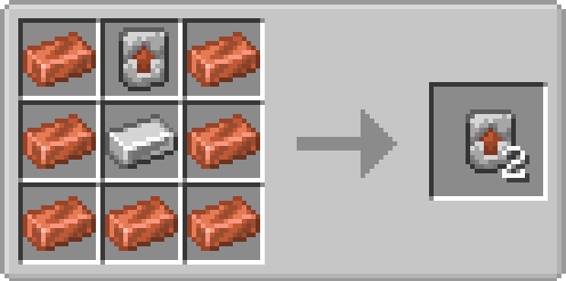
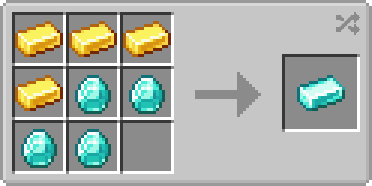

----

  

This mod is a reimagining of one of my previous mods, tweaking Minecraft equipment progression for casual players to make sense within the game's implied progression system, by adding diamond ingots, the new way to craft diamond equipment, and tweaking properties of different armors and weapons.

"The game's "implied" progression system?" I hear you ask- oh, you didn't? Well, this is my mod, so let me explain anyway:

Progression has been reorganized in the order equipment should be obtained, with tools mostly being unchanged:
Copper armor is upgraded from leather (without a template), chainmail is now craftable and can be upgraded with either gold or iron, with iron giving you more protection while sacrificing your speed, and gold being the opposite; making you 5% faster with a whole set, at the cost of the same protection as the chainmail armor. Diamond is upgraded from iron armor, giving you more protection at the cost being even slower, and netherite is upgraded from gold armor, netherite ingots now using gold armor, being even heavier than diamond armor despite it's lighter base, though it is still the strongest armor in the game.

The only big change to tools are gold swords and axes do the same damage as iron, and netherite swords and axes are much slower due to their weight. 

To still make netherite a viable choice when compared to gold or even just diamond, I added a new enchantment called 'Swift Strike' which increases your weapons attack speed! You can find it as a treasure enchantment, or for those who want a really broken sword as a reward for exploring, you can find a gold sword with the enchantment already applied.

This mod also replaces the Netherite Upgrade Template with the new Plate Forger, which can be found just about anywhere you'd expect to find one of the old templates, and a few other places as well. Since Netherite Upgrade Templates do still exist in the game, you can exchange them for 7 diamonds if you put them in any crafting grid.

----

----

# Q&A 

### Q: Can I use this in my modpack?
A: Of course! This mod was meant for modpacks!

### Q: Can I redistribute this?
A: Unless you ask permission or you're in a third-world country, no.

### Q: There's a bug, how can I report it?
A: Submit an issue on GitHub! [Click here to do that](https://github.com/kckarnige/ToolTouchupsReWaxed/issues), or check the "links" tab on Modrinth.

### Q: How can I support what you do?
A: If you like what I do, you can donate to my [Ko-Fi](https://ko-fi.com/kckarnige), my CashApp, or [buy me a coffee](https://buymeacoffee.com/kckarnige)!